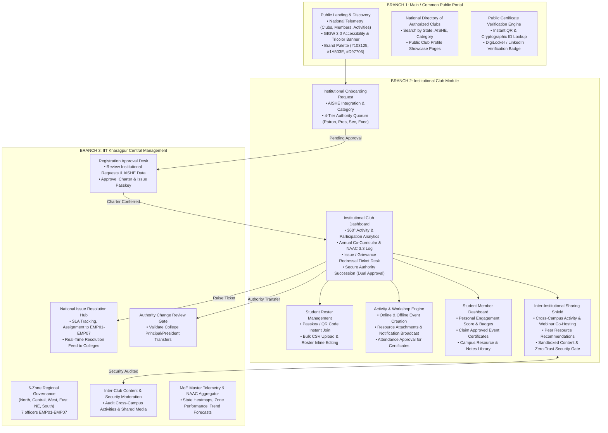
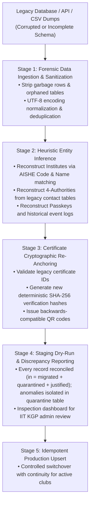

# Master Architecture & Implementation Plan: NDLI Club Portal 2.0

> **Client:** National Digital Library of India (NDLI), IIT Kharagpur & Ministry of Education, Government of India  
> **Lead Architect & Developer:** Dr. Anirban Mukherjee  
> **Strategic Goal:** Deliver a world-class, high-security, elegant, and fault-tolerant portal to replace the legacy system (`club.ndl.iitkgp.ac.in`), outperforming delayed internal efforts and securing the official development contract.

---

## 1. Executive Summary & Design Tenets

The next-generation NDLI Club platform connects thousands of schools, colleges, and universities across India to NDLI's academic resource repository (headline scale figures [NDLI TO CONFIRM]; see the proposal). To satisfy national educational goals (NEP 2020) and overcome past operational failures, the portal is designed around three non-negotiable pillars:

1. **Brand Identity & Visual Elegance (Direction C — Soft Modern SaaS):**
   - Rooted in the official NDLI primary palette: Deep Forest Green (`#103125`), NDLI Brand Green (`#1A503E`), Emerald (`#0D7751`), and soft pastel canvas surfaces (`#F4F8F6`, `#E9F5EF`).
   - Complemented by Warm Amber (`#D97706`, `#F59E0B`) for calls-to-action and Sky/Indigo accents for informational cues.
   - High-legibility typography pairing **Manrope** (bold metrics, headings) and **Inter** (accessible body text).

2. **Simplicity in Operation with Uncompromising Security:**
   - Designed for seamless use by college librarians, senior academic directors, and undergraduate students alike.
   - Built to meet **CERT-In audit standards**, **GIGW 3.0 guidelines**, and strict role-based access control (RBAC) with cryptographic signing.

3. **Three-Tier Architectural Separation:**
   - **Branch 1:** Common Public Landing & Resource Discovery Portal.
   - **Branch 2:** Institutional Club Space (Club Dashboard, Student Dashboard, Inter-Institutional Sharing Shield).
   - **Branch 3:** Central IIT Kharagpur Administration & Regional Management Module (built upon the 7-zone governance structure of `ndli-club-management`).

---

## 2. High-Level Portal Structure (The 3 Main Branches)

---

## 3. Detailed Specification by Module

### Branch 1: Main / Common Public Landing Page
1. **Design System & Visual Language:**
   - Primary: `#103125` (Dark Forest), `#1A503E` (NDLI Brand Green), `#0D7751` (Emerald).
   - Canvas: `#F4F8F6` tinted surface with `#FFFFFF` elevated cards and `#E2ECE7` hairlines.
   - Highlights: Amber `#D97706` / `#F59E0B` for action buttons and badges.
   - Indian Government GIGW 3.0 Tricolor header, Screen Reader toggle, High Contrast mode, font-size adjuster (`A- / A / A+`), and bilingual toggle (English / हिंदी).
2. **National Telemetry Counters:**
   - Real-time counts for Active Chartered Clubs, Registered Student Learners, Annual Co-Curricular Activities, and Issued QR-Verifiable Certificates.
3. **National Club Directory & Search:**
   - Multi-parameter filter across Indian States, Union Territories, AISHE codes, and institution types (Universities, Autonomous Colleges, Schools).
   - Generates clean public showcase profile URLs (e.g. `/clubs/IITKGP-NDL-9021`).
4. **Public Credential Verification Portal:**
   - Direct verification lookup by Certificate ID (`NDLI-XXXX-XXXX`, unambiguous alphabet) or scanned QR code, showing cryptographic validation seal, recipient details, and issuing authority.

---

### Branch 2: Institutional Club Module

#### 3a & 3b. Onboarding Request to Approved Club Profile
- **Registration Request:** Institution submits AISHE code (with auto-lookup), institute details, official contact, and the 4-tier governance quorum:
  1. **Patron:** Head of Institution (Principal / Director / Vice Chancellor).
  2. **President:** Faculty Member / University Librarian.
  3. **Secretary:** Faculty Coordinator / NSS Lead.
  4. **Executive Member:** Student Council / Literary Club Lead.
- **Approval Lifecycle:**
  - Status transitions: `PENDING_VERIFICATION` → `APPROVED_CHARTERED` (or `REVISION_REQUIRED`).
  - Upon IIT KGP approval, the system auto-generates:
    - Unique **Institutional Passkey** (e.g. `IITB-NDL-4412`).
    - Dedicated **Public Club Showcase Profile Page**.
    - Authenticated **Club Administration Dashboard**.

#### 3c.i. Student Onboarding & Editable Member Roster
- **Two Flexible Onboarding Modes:**
  1. *Student Self-Join:* Students enter the club Passkey or scan the dynamic campus QR code.
  2. *Bulk Administrative Upload:* Club coordinators upload a CSV/Excel roster containing `Full Name`, `Roll/Enrollment No`, `Department`, `Email`, and `Year`.
- **Full Roster CRUD & Lifecycle:**
  - Coordinators can edit student details individually or perform bulk updates.
  - Ability to promote students to Club Volunteers or deactivate graduated students while preserving historical participation logs.

#### 3c.ii & 3c.iii. Co-Curricular Activity & Event Management Engine
- **Event Creation Workflow:**
  - Form fields: Event Title, Category (*Quiz, Reading Challenge, Workshop, Seminar, Webinar*), Mode (*Online, Offline In-Campus, Hybrid*), Date/Time, Resource links (deep-linked to NDLI repository), and detailed brochure/description.
  - Automated notification broadcast: In-app alerts, calendar invites, and notification feed for all enrolled club students.
- **Annual Co-Curricular Activity Log:**
  - Permanent digital repository of all events conducted throughout the academic calendar.
  - Serves as the primary data feeder for **NAAC Criteria 3.3.3 / 3.3.4 (Extension Activities)** and NIRF documentation.

#### 3c.iv. Central Grievance & Issue Redressal Module
- Dedicated ticketing desk inside the Club Dashboard:
  - Categories: *Registration & Passkey Issues, Certificate Approvals, Event Logistics, Technical Assistance, Data Corrections*.
  - Every ticket receives a unique tracking ID (`TKT-2026-XXXX`), priority flag (`Low`, `Medium`, `High`, `Urgent`), and live status tracker (`Submitted` → `Under Review by Regional Node` → `Resolved`).
  - Seamlessly routes into the IIT Kharagpur Administration Module.

#### 3c.v. Secure Authority & Member Succession Workflow
- Changes to Key Authorities (e.g. new Principal, new Librarian) require high security to prevent unauthorized takeovers:
  - Initiated by the current President or Patron.
  - Requires **Dual-Factor Security Verification**: Email OTP token sent to official institutional addresses plus upload of official appointment letter/transfer order.
  - Changes are routed to IIT Kharagpur Admin for final cryptographic re-signing of the charter.

#### 3c.vi. Student Dashboard & Verifiable Micro-Credentials
- **Personalized Student Workspace:**
  - Active club membership badge with college affiliation.
  - Engagement metrics: Number of activities attended, books logged, reading streak, and national literacy tier (*Bronze, Silver, Gold, Diamond Scholar*).
- **Certificate Issuance Protocol:**
  - Participation e-certificates are **not** auto-issued blindly: they require the **Event Organizer / Club President's attendance sign-off** before being unlocked.
  - Once approved, students can download high-resolution vector certificates with embedded verification QR code, and export to DigiLocker or LinkedIn.
- **Campus & Inter-College Resource Sharing:**
  - Notes, book reviews, and research summaries shared within their campus chapter.

#### 3c.vii. Inter-Institutional Resource & Activity Sharing Shield
> [!IMPORTANT]
> **The Core Vision: Eradicating Geographical and Physical Barriers**
> The true power of the NDLI Club network is enabling a college in rural Assam, an engineering college in Maharashtra, and a central university in Delhi to collaborate, share academic resources, and co-host national competitions without friction.

**The Cyber Security Shield Architecture:**
- **Zero-Trust Cross-Institution Gateway:**
  - Any event or resource designated as "Public / Inter-Institutional" passes through an automated sanitization gate (blocking executable payloads, malicious URL embeds, phishing scripts, or unverified external forms).
- **Federated Co-Hosting Permissions:**
  - Club A can invite Club B as a *Co-Host*, granting their students instant guest access without separate re-registration.
- **Resource Sandboxing:**
  - Shared lecture notes, book reviews, and reading guides are rendered in sandboxed previews with Content Security Policy (CSP) enforcement.

---

### Branch 3: IIT Kharagpur NDLI Administration / Management Module
Harmonized with Dr. Anirban Mukherjee's existing **`ndli-club-management`** 7-zone operational architecture:

1. **6-Zone Regional Structure (7 Officers):**
   - **North:** J&K, Ladakh, HP, Punjab, Haryana, Delhi, UP, Uttarakhand (`EMP01`).
   - **Central:** Madhya Pradesh, Chhattisgarh (`EMP02`).
   - **West:** Rajasthan, Gujarat, Maharashtra, Goa (`EMP03`).
   - **East:** West Bengal, Bihar, Jharkhand, Odisha (`EMP04`).
   - **North East:** Assam, Meghalaya, Manipur, Mizoram, Tripura, Nagaland, Arunachal, Sikkim (`EMP05`).
   - **South:** one zone served by two officers — Andhra Pradesh, Telangana, Karnataka (`EMP06`, "South Zone 1") and Tamil Nadu, Kerala, Puducherry, Islands (`EMP07`, "South Zone 2").
2. **Master Control Desks:**
   - **Institutional Approval Desk:** Filter pending onboarding requests by Zone and State. Review AISHE accreditation, contact authenticity, and 1-click Approve with Passkey generation or Request Resubmission.
   - **National Ticket Dispatch & Resolution Desk:** View all tickets raised across India; assign to respective zonal employee nodes (`EMP01` to `EMP07`); track resolution SLAs (e.g. 24h for critical passkey issues).
   - **Authority Change Authorization Desk:** Verify appointment documents and sign off on leadership transitions.
   - **Inter-Club Security Audit Monitor:** Flag and audit cross-campus events and public student resources for compliance and cybersecurity.
   - **Master Analytics & NAAC Aggregator:** National penetration map, top-performing institutional clubs, and Ministry of Education monthly report exporter.

---

## 4. The Data Migration Strategy (Handling the Legacy System)

> [!CAUTION]
> **The Real-World Dilemma:**
> The legacy system (`club.ndl.iitkgp.ac.in`) is being replaced; it ships undocumented schemas, broken entity relationships, and possible data corruption. Neither the internal team nor external stakeholders possess a clean data dictionary.

### The 5-Stage Forensic Data Extraction & Healing Pipeline

1. **Stage 1: Raw Forensic Extraction & Sanitization:**
   - Ingest raw database dumps (SQL, JSON, or CSV).
   - Strip hidden scripts, invalid foreign key constraints, and corrupted Unicode characters.
2. **Stage 2: Heuristic Entity Mapping & Healing:**
   - *Clubs:* Match fragmented college records against the official All India Survey on Higher Education (AISHE) master list to automatically heal misspelled names, missing districts, or blank categories.
   - *Passkeys:* Preserve existing passkeys where valid; assign deterministically formatted replacements for broken records with automatic email notification to the registered President.
   - *Authorities:* Consolidate disparate user records into the clean 4-tier model (Patron, President, Secretary, Executive Member).
3. **Stage 3: Certificate Re-Anchoring (Backwards Compatibility):**
   - Every legacy certificate record is preserved.
   - Re-anchor past certificates with unique verification hashes so that old certificate links and printouts remain verifiable on the new portal (`/verify/{legacy_id}`).
4. **Stage 4: Quarantine & Discrepancy Auditing:**
   - Any record with unresolvable integrity errors (e.g. invalid institute name, corrupted timestamps) is placed into a dedicated **Migration Quarantine Table**.
   - Admin module provides an interactive interface for regional officers (`EMP01`-`EMP07`) to review and approve healed records.
5. **Stage 5: Idempotent Dual-Write & Controlled Cutover:**
   - Automated import scripts can be run repeatedly without duplicating records (`UPSERT` on AISHE / Club ID).

---

## 5. Security & Compliance Architecture

1. **Role-Based Access Control (RBAC):**
   - Strictly enforced roles: `SUPER_ADMIN` (IIT KGP Office), `REGIONAL_OFFICER` (Zonal Nodes EMP01-EMP07), `CLUB_PATRON`, `CLUB_PRESIDENT`, `CLUB_SECRETARY`, `CLUB_EXECUTIVE`, and `STUDENT_MEMBER`.
2. **Input Sanitization & Injection Prevention:**
   - No raw SQL; all queries parameterized or ORM-sanitized.
   - Strict XSS filtering on all activity descriptions and student discussion submissions.
3. **CERT-In & GIGW 3.0 Hardening:**
   - Content Security Policy (CSP), HTTP Strict Transport Security (HSTS), X-Frame-Options (`DENY`), and secure cookie headers.
   - No sensitive passwords or credentials stored in plain text (Argon2 / bcrypt hashing).
4. **Rate Limiting & DDoS Mitigation:**
   - Rate limiting on passkey redemption and certificate verification endpoints to prevent brute-force scrapers.

---

## 6. Implementation Phasing & Next Steps

### Phase 1: High-Fidelity Master Prototype (Current Development Target)
- Refactor portal design to match the authentic **NDLI Green & Amber Brand Palette** (`#103125`, `#1A503E`, `#0D7751`, `#D97706`).
- Implement the **Three Master Branches** with smooth navigation:
  1. *Common Landing:* Hero with national telemetry, club finder, GIGW accessibility, public verifier.
  2. *Club Module:*
     - Club Onboarding wizard.
     - Live Club Profile showcase page.
     - Institutional Club Dashboard (activity log, roster bulk CSV import, issue ticketing desk, authority succession modal).
     - Student Member Dashboard (ratings, event certificates, campus notes).
     - Inter-Institutional Activity Sharing Shield (co-hosted cross-campus events with security audit badges).
  3. *IIT Kharagpur Administration Module:*
     - 6-zone regional breakdown (7 officers, `EMP01`-`EMP07`).
     - Club Registration Approval queue.
     - Central Ticket Grievance Desk.
     - Authority Change approval workflow.
     - Forensic Data Migration health dashboard.
- Integrated interactive pitch presentation drawer.

### Phase 2: Production Deployment & Data Ingestion (Post-Contract Award)
- Connect to PostgreSQL / Redis cluster on IIT KGP cloud infrastructure.
- Execute the Forensic Data Migration pipeline on legacy database dumps.
- Conduct CERT-In security penetration testing and user acceptance sign-off with regional coordinators.
